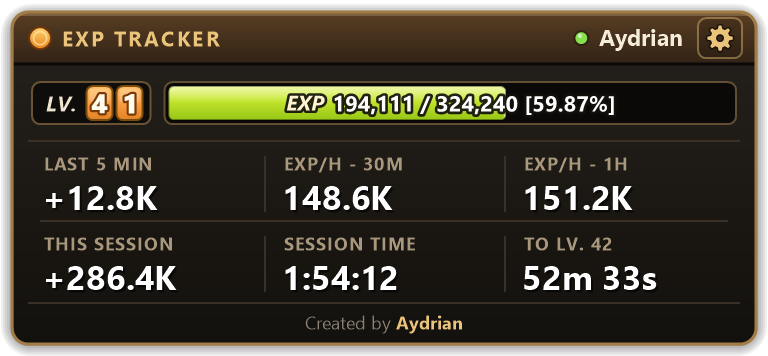
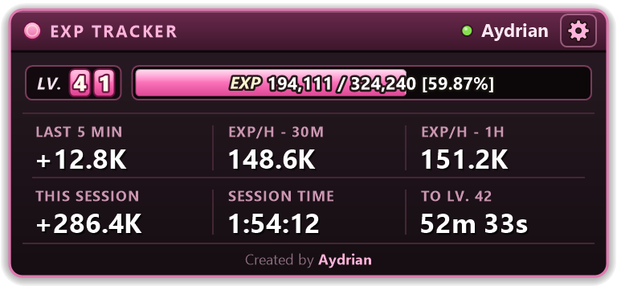
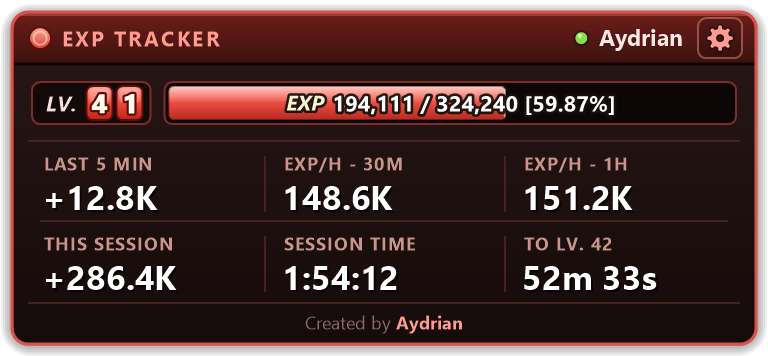
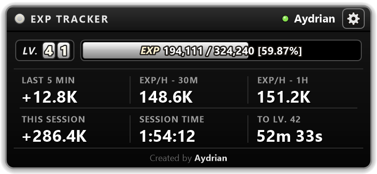
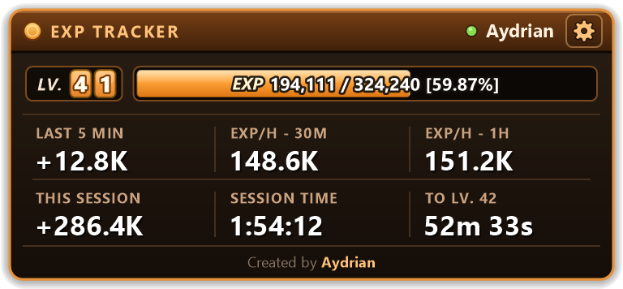
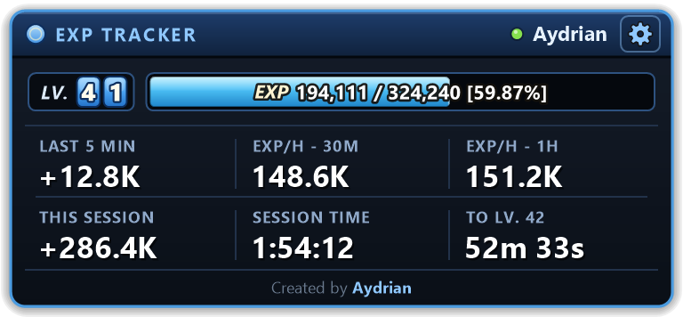
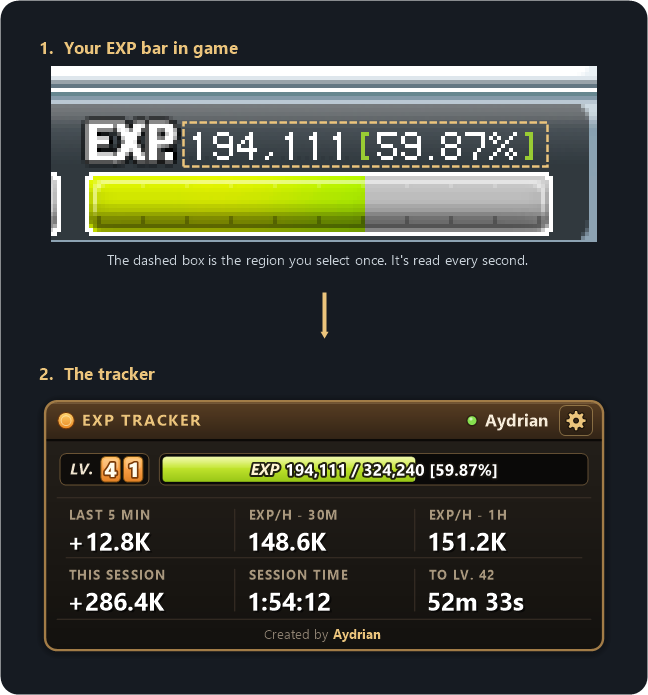
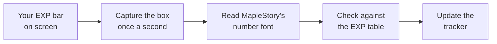
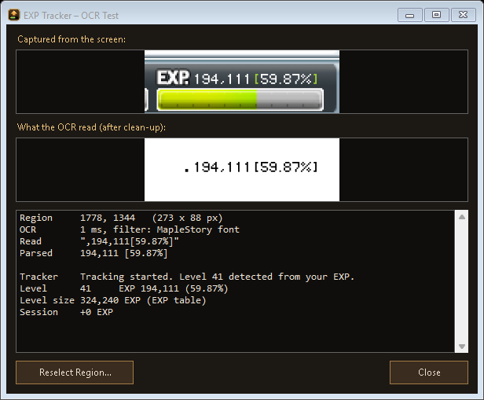
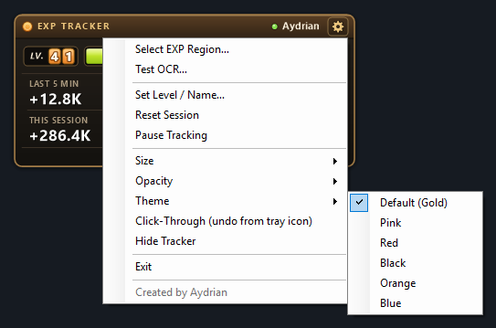

# MapleStory Classic EXP Tracker

**A clean, always-on-top EXP tracker for MapleStory Classic.**
See your EXP per hour, session EXP and time to level while you grind.

*Created by Aydrian*

### [⬇ Download the latest version](https://github.com/xEmPIr3/MapleStory-EXP-Tracker/releases/latest)

Windows 10 / 11 · one small .exe · no install

---

## What it shows

| | |
|---|---|
| **LV + EXP bar** | Your level and a live EXP bar: current EXP / EXP needed for the level, and the percentage |
| **LAST 5 MIN** | EXP gained in the last 5 minutes |
| **EXP/H - 30M** | EXP per hour over the last 30 minutes |
| **EXP/H - 1H** | EXP per hour over the last hour |
| **THIS SESSION** | Total EXP gained this session |
| **SESSION TIME** | How long you've been grinding (the clock stops while paused) |
| **TO LV. N** | Time until your next level at your current pace |

## Features

- Reads your EXP straight from the screen and updates every second
- Detects your level automatically (levels 1–99)
- Counts level ups and death penalties correctly
- Ignores your mouse cursor or a window passing over the numbers
- 6 themes, adjustable size and opacity, and a click-through mode for playing
- Stays on top of the game and remembers its position and settings
- No install, no account, no internet connection needed

## Themes

Pick one from the settings menu. Your choice is remembered.

| | |
|:---:|:---:|
|  **Default (Gold)** |  **Pink** |
|  **Red** |  **Black** |
|  **Orange** |  **Blue** |

## How it works

1. **You draw a box once** around the EXP numbers in the game's status bar.
2. **Every second** the tracker takes a picture of just that box.
3. **It reads MapleStory's own pixel font** digit by digit, so the numbers are exact. Windows' built-in text
   recognition is used as a backup.
4. **It checks every reading against the EXP table.** EXP ÷ percentage has to match exactly one level, so it
   knows your level, and a bad reading (your cursor over the numbers, a popup) is thrown away instead of
   messing up your stats.
5. **Your gains add up** into EXP per hour, session EXP and time to level. Level ups count the EXP that
   finished the old level plus what carried over; deaths subtract the EXP you lost.

The tracker **never touches the game's memory or files**. It only looks at the screen, the same way you do.

### Not reading your EXP?

Click the gear → **Test OCR…** to see exactly what the tracker captures, what it reads and what it makes of it.

## Getting started

1. **[Download](https://github.com/xEmPIr3/MapleStory-EXP-Tracker/releases/latest)** `MapleExpTracker.exe`.
2. **Run it.** Windows may say *"Windows protected your PC"* because the app isn't code-signed. Click
   **More info → Run anyway**.
3. **Start MapleStory Classic** in windowed or borderless mode (exclusive fullscreen can't be captured).
4. **Click the gear** at the top right of the tracker → **Select EXP Region…**, then drag a box around your EXP
   numbers, e.g. `194,111 [59.87%]`. A magnifier helps you line it up.

That's it. The dot in the header turns green while your EXP is being read.

## Settings

Everything is in the menu behind the **gear** button (right-clicking the tracker opens it too):

| | |
|---|---|
| **Select EXP Region…** | Draw the box around your EXP numbers |
| **Test OCR…** | See what the tracker reads |
| **Set Level / Name…** | Change the name in the header (the level is detected for you) |
| **Reset Session** | Start the session stats from zero |
| **Pause Tracking** | Stop counting while you take a break |
| **Size / Opacity / Theme** | Make it look the way you like |
| **Click-Through** | Let clicks pass through the tracker to the game. Turn it off again from the tray icon |
| **Hide Tracker / Exit** | Hide it or close it (it also lives in the system tray) |

Drag the tracker anywhere to move it. Double-click the level or name to change them.

## FAQ

**What do I need?**
Windows 10 or 11. Nothing else to install.

**Can this get me banned?**
The tracker only reads pixels from your screen. It doesn't read or change the game's memory, inject anything
or send any input. That said, any third-party tool may be against the game's terms of service, so use it at
your own risk.

**Where are my settings stored?**
In `settings.ini` next to the exe. A small `tracker.log` notes level changes for troubleshooting. Nothing ever
leaves your PC.

**My antivirus complains.**
Screen-reading overlays sometimes trigger false positives. Only download the tracker from this page.

## Credits

Created by **Aydrian**. EXP table data from [meowdb.com](https://meowdb.com/msclassic/guides/exp-table-level-1-to-100).

MapleStory is a trademark of NEXON Korea Corporation. This project is not affiliated with or endorsed by Nexon.

## License

© 2026 Aydrian. All rights reserved. Free to download and use. Don't re-upload, sell or modify it.
See [LICENSE](LICENSE).
